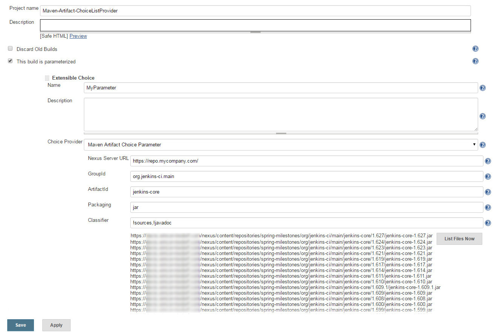
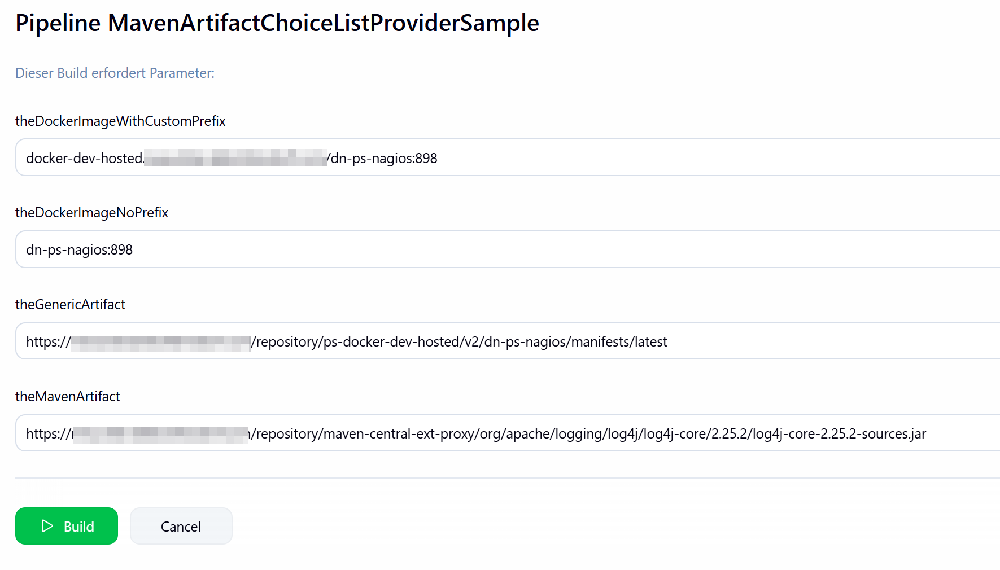
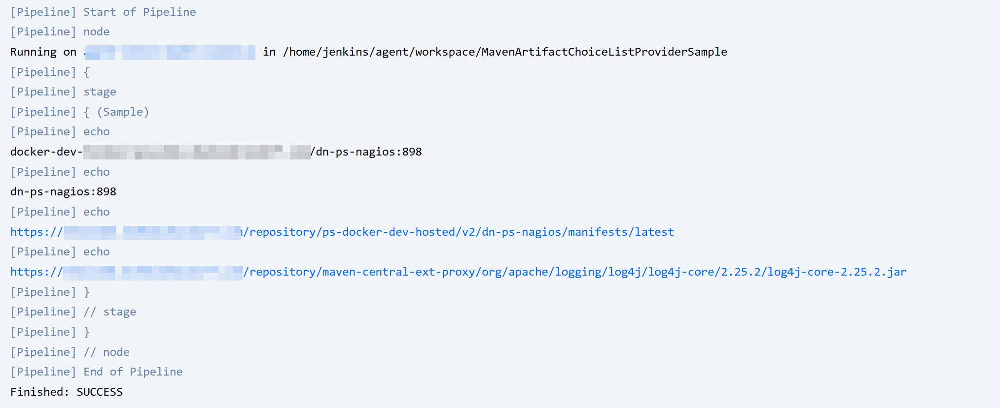
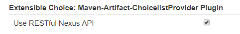

# MavenArtifact ChoiceListProvider
[](https://ci.jenkins.io/job/Plugins/job/maven-artifact-choicelistprovider-plugin/job/master)
[](https://github.com/jenkinsci/maven-artifact-choicelistprovider-plugin/graphs/contributors)
[](https://plugins.jenkins.io/maven-artifact-choicelistprovider)
[](https://github.com/jenkinsci/maven-artifact-choicelistprovider-plugin/releases/latest)
[](https://plugins.jenkins.io/maven-artifact-choicelistprovider)

## What does this  this - Overview
This plugin adds an additional ChoiceListProvider to famous <a href="https://plugins.jenkins.io/extensible-choice-parameter">Extensible Choice Parameter</a> plugin.

This Jenkins extension allows you to interact with Service APIs from Maven repositories such as:

- **Nexus 2**
- **Nexus 3**
- **Maven Central**
- **Artifactory**

It enables searching for artifacts using various parameters, including:

- `artifactId`
- `groupId`
- `packaging`

---

## Features

### ✅ Artifact Search
Search for artifacts in the selected repository using flexible parameters.

### ✅ Version Selection
The plugin provides a build parameter that lets users choose a version from the available artifacts in the chosen repository.

### ✅ Artifact URL Retrieval
Once a version is selected, the plugin returns the **full URL** of the chosen artifact.  
This URL is exposed as an **environment variable** during the build, making it easy to download the artifact using:

```bash
wget $ARTIFACT_URL
## or
curl $ARTIFACT_URL
```

###  ✅ Docker Image Support
The plugin can also retrieve Docker images and list available tags.

## Usage
You can use this plugin in:

- Classic Jenkins Jobs
- Declarative Pipelines

## Configuration Sample UI
We are using this plugin to let our QA department choose between the various available versions of our software. In combination with the "Publish via SSH" plugin the choosen artifact URL is passed to the testserver which is then able to retrieve the artifact and install it.

### Configuration UI Sample


## Pipeline Example
### Declarative Pipeline
```
pipeline {
    agent any
    
    parameters {
        nexus3DockerImage(name: 'theDockerImageWithCustomPrefix', url: "https://repo.company.com", imagePrefix: "docker-dev-hosted.repo.company.com/", repository: "ps-docker-dev-hosted", group: "", imageName: 'dn-ps-nagios', credentialsId: "my-credential-id", reverseOrder: true)
        
        nexus3DockerImage(name: 'theDockerImageNoPrefix', url: "https://repo.company.com", imagePrefix: "", repository: "ps-docker-dev-hosted", group: "", imageName: 'dn-ps-nagios', credentialsId: "my-credential-id", reverseOrder: true)
        
        nexus3Generic(name: 'theGenericArtifact', url: "https://repo.company.com", repository: "ps-docker-dev-hosted", assetName: 'dn-ps-nagios', credentialsId: "my-credential-id")
        
        nexus3Maven(name: 'theMavenArtifact', url: "https://repo.company.com", repository: "maven-central-ext-proxy", groupId: "org.apache.logging.log4j", artifactId: 'log4j-core', packaging: 'jar', credentialsId: "my-credential-id")


        artifactoryDockerImage(name: 'artifactoryDockerImageWithCustomPrefix', url: "https://repo.company.com", imagePrefix: "repo.company.com/docker-dev-hosted/", repository: "docker-releases-hosted", group: "", imageName: 'sub/dn-ps-nagios', credentialsId: "my-credential-id", reverseOrder: true)
        
        artifactoryDockerImage(name: 'artifactoryDockerImageNoPrefix', url: "https://repo.company.com", imagePrefix: "", repository: "docker-dev-hosted", group: "", imageName: 'dn-ps-nagios', credentialsId: "my-credential-id", reverseOrder: true)
        
        artifactoryMaven(name: 'artifactoryMavenArtifact', url: "https://repo.company.com", repository: "maven-central-ext-proxy", groupId: "org.apache.logging.log4j", artifactId: 'log4j-core', packaging: 'jar', credentialsId: "my-credential-id")
        
        artifactoryMavenVersionOnly(name: 'artifactoryMavenVersionOnly', url: "https://repo.company.com", repository: "maven-central-ext-proxy", groupId: "org.apache.logging.log4j", artifactId: 'log4j-core', packaging: 'jar', credentialsId: "my-credential-id")
    }
    
    stages {
        stage("Sample") {
            steps {
                echo "$theDockerImageWithCustomPrefix"
                echo "$theDockerImageNoPrefix"
                echo "$theGenericArtifact"
                echo "$theMavenArtifact"

                echo "$artifactoryDockerImageWithCustomPrefix"
                echo "$artifactoryDockerImageNoPrefix"
                echo "$artifactoryMavenArtifact"
                echo "$artifactoryMavenVersionOnly"
            }
        }
    }
}
  ```

### Declarative Pipeline in UI


### Declarative Pipeline Console Output


# Known Issues
## Nexus Snapshots
If you would like to use Snapshot Versions of your artifacts you have to enable the tick-box in the Jenkins Settings. Only with the RESTful interface of Nexus 2 you will be able to retrieve Snapshot versions.



## Artifactory
Artifactory has been introduced in earlier versions already and with the November '26 update it has been enhanced. For Artifactory the plugin now supports to do a Maven2 artifact searched based on GAVC (GroupId, ArtifactId, Version, Classifier) parameters. There is also one ChoiceListProvider to find also the version numbers of an artifact.

Finding DockerImages (and Helm Packages) is also now supported.

The plugin supports the configuration as a usual build parameter in the job configuration or as a parameter in a declarative pipeline.

# Continouos Delivery
https://ci.jenkins.io/job/Plugins/job/maven-artifact-choicelistprovider-plugin/

## Authors
Stephan Watermeyer (Profile: https://github.com/phreakadelle)


## License
Licensed under the [MIT License (MIT)](https://github.com/heremaps/buildrotator-plugin/blob/master/LICENSE).
